

 

 


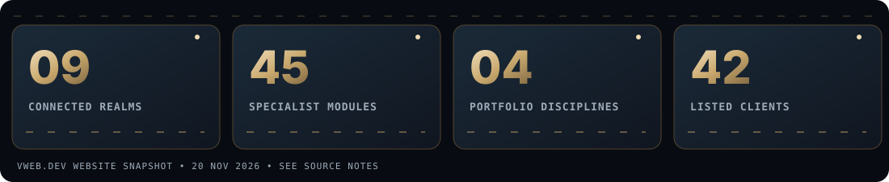

**VWEB.DEV** is an independent digital product and creative studio founded by **Zeeshan Ali Raza** in 2014, based in Lahore, Pakistan. We work across strategy, design, engineering, integrations, automation, growth and support — from initial product concepts through practical implementation.

> The goal is not to accumulate features. It's to build coherent, maintainable products that solve a real problem.

 


 

Discover → Design → Engineer → Evolve · A connected delivery system

 


*Technologies and tooling vary by engagement. These are representative capabilities, not a claim that every project uses every tool.*

**Explore the full [45-module service catalogue](docs/SERVICES.md), [technology architecture](docs/TECHNOLOGY.md) and [studio engagement model](docs/STUDIO.md).**

 

 

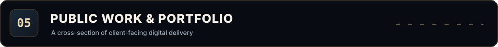
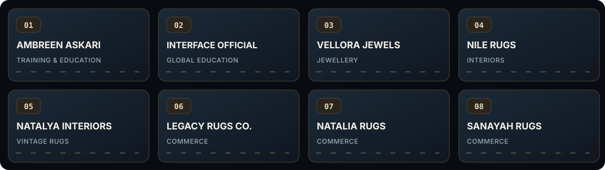

<a href="https://vweb.dev/portfolio"><b>EXPLORE WEBSITE PORTFOLIO ↗</b></a> &nbsp;·&nbsp; <a href="docs/PORTFOLIO.md"><b>VIEW SELECTED WORK & CLIENT DIRECTORY</b></a>

Portfolio figures and client names above reflect the business website's own catalogue and are not independent audits.

 

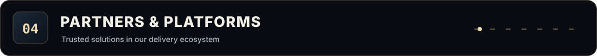
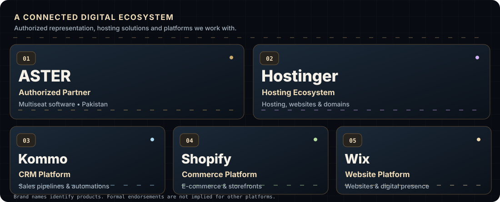

[**ASTER Pakistan**](https://aster.vweb.dev/en) &nbsp;•&nbsp; [**Hostinger**](https://www.hostinger.com/) &nbsp;•&nbsp; [**Kommo CRM**](https://www.kommo.com/) &nbsp;•&nbsp; [**Shopify**](https://www.shopify.com/) &nbsp;•&nbsp; [**Wix**](https://www.wix.com/)

**Partnership transparency:** VWEB.DEV identifies itself as an authorized ASTER partner in Pakistan. Other names in this section represent platforms in the business and technology ecosystem; their inclusion alone does not indicate certified or official partner status.

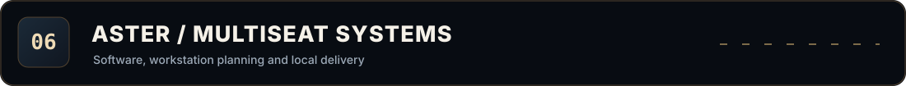
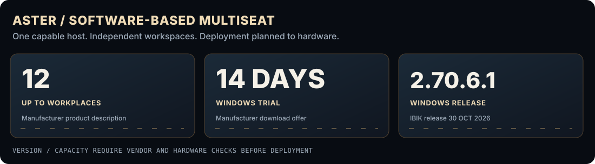

[**ASTER Pakistan**](https://vweb.dev/aster-pakistan) &nbsp;·&nbsp; [**Technical & Licensing Guide**](docs/ASTER.md) &nbsp;·&nbsp; [**Manufacturer Downloads**](https://ibiksoft.com/download-aster-multiseat-software/)

Product version is sourced from IBIK's release page, not the older version references currently present on some Pakistan marketing sections. Compatibility and licensing must be reviewed per deployment.

<a href="https://github.com/vweb-dev/connect.vweb.dev"></a>

<a href="https://github.com/vweb-dev/Interface-Front"></a>

<a href="https://github.com/vweb-dev?tab=repositories"><b>EXPLORE PUBLIC REPOSITORIES ↗</b></a>

These cards link only to public repositories. Client codebases and private engagements are intentionally excluded. Not all listed projects are production services.

 
 


Snapshot figures are not live. The streak widget is provided by an independent service and may be unavailable or rate-limited.

 

<!-- VWEB:PUBLIC-REPOS:START -->
## Public project directory

**27 public project repositories**, automatically synced from GitHub. Private work remains private.

### PHP / Laravel

| Repository | GitHub language |
|---|---|
| [booking-jules ](https://github.com/vweb-dev/booking-jules) | PHP |
| [connect.vweb.dev ](https://github.com/vweb-dev/connect.vweb.dev) | JavaScript |
| [luxury-talent-booking-rce ](https://github.com/vweb-dev/luxury-talent-booking-rce) | PHP |

### Applications & Websites

| Repository | GitHub language |
|---|---|
| [blackboxai-1755427024873 ](https://github.com/vweb-dev/blackboxai-1755427024873) | Unclassified |
| [CanPak-web-app ](https://github.com/vweb-dev/CanPak-web-app) | PowerShell |
| [folting-filter-menu ](https://github.com/vweb-dev/folting-filter-menu) | Unclassified |
| [Interface-Front ](https://github.com/vweb-dev/Interface-Front) | Unclassified |
| [o2-clone ](https://github.com/vweb-dev/o2-clone) | HTML |
| [PCMEA-Connect ](https://github.com/vweb-dev/PCMEA-Connect) | TypeScript |
| [POD-WP ](https://github.com/vweb-dev/POD-WP) | Unclassified |
| [studyapp ](https://github.com/vweb-dev/studyapp) | Unclassified |
| [yasser.ai- ](https://github.com/vweb-dev/yasser.ai-) | Unclassified |

### Utilities & Tools

| Repository | GitHub language |
|---|---|
| [canada-csr-calculator ](https://github.com/vweb-dev/canada-csr-calculator) | JavaScript |
| [daraz-calculator ](https://github.com/vweb-dev/daraz-calculator) | JavaScript |
| [rdp-wrapper-library ](https://github.com/vweb-dev/rdp-wrapper-library) | Python |
| [rdpwrap ](https://github.com/vweb-dev/rdpwrap) | Pascal |

### Community & Upstream

| Repository | GitHub language |
|---|---|
| [api-anything ](https://github.com/vweb-dev/api-anything) | Unclassified |
| [envato-elements-downloader ](https://github.com/vweb-dev/envato-elements-downloader) | Unclassified |
| [Filee ](https://github.com/vweb-dev/Filee) | Unclassified |
| [Microsoft-Activation-Scripts ](https://github.com/vweb-dev/Microsoft-Activation-Scripts) | Batchfile |
| [motion-design-skill ](https://github.com/vweb-dev/motion-design-skill) | Unclassified |
| [Open-Typer ](https://github.com/vweb-dev/Open-Typer) | Unclassified |
| [OpenBoard ](https://github.com/vweb-dev/OpenBoard) | Unclassified |
| [shopify-app ](https://github.com/vweb-dev/shopify-app) | Unclassified |
| [swarm-cursors ](https://github.com/vweb-dev/swarm-cursors) | Unclassified |
| [taskreminder ](https://github.com/vweb-dev/taskreminder) | Unclassified |
| [vapsstore ](https://github.com/vweb-dev/vapsstore) | Unclassified |

Only public metadata is used. Directory refresh is scheduled; empty, template and upstream repositories are not necessarily completed VWEB.DEV products.
<!-- VWEB:PUBLIC-REPOS:END -->

[**Visit website**](https://vweb.dev) &nbsp;&nbsp;•&nbsp;&nbsp; [**Send an email**](mailto:info@vweb.dev) &nbsp;&nbsp;•&nbsp;&nbsp; [**Chat on WhatsApp**](https://wa.me/923214433994)

 

**[Full Studio Reference & Source Notes](docs/README.md)** · [Partners](docs/PARTNERS.md) · [Portfolio](docs/PORTFOLIO.md) · [Source Verification](docs/SOURCES.md)

[README Automation Documentation](docs/README-AUTOMATION.md)

<!-- Custom GitHub profile created for vweb-dev. All vector graphics are original and do not substitute for or modify the official VWEB.DEV brand logo. -->