 

 

**VWEB.DEV** is an independent digital product and creative studio founded by **Zeeshan Ali Raza** in 2014, based in Lahore, Pakistan. We work across strategy, design, engineering, integrations, automation, growth and support — from initial product concepts through practical implementation.

> The goal is not to accumulate features. It's to build coherent, maintainable products that solve a real problem.

 

 

Discover → Design → Engineer → Evolve · A connected delivery system

 

*Technologies and tooling vary by engagement. These are representative capabilities, not a claim that every project uses every tool.*

 

 

[**ASTER Pakistan**](https://aster.vweb.dev/en) &nbsp;•&nbsp; [**Hostinger**](https://www.hostinger.com/) &nbsp;•&nbsp; [**Kommo CRM**](https://www.kommo.com/) &nbsp;•&nbsp; [**Shopify**](https://www.shopify.com/) &nbsp;•&nbsp; [**Wix**](https://www.wix.com/)

**Partnership transparency:** VWEB.DEV identifies itself as an authorized ASTER partner in Pakistan. Other names in this section represent platforms in the business and technology ecosystem; their inclusion alone does not indicate certified or official partner status.

<a href="https://github.com/vweb-dev?tab=repositories"><b>EXPLORE PUBLIC REPOSITORIES ↗</b></a>

These cards link only to public repositories. Client codebases and private engagements are intentionally excluded. Not all listed projects are production services.

 
 

Snapshot figures are not live. The streak widget is provided by an independent service and may be unavailable or rate-limited.

 

[**Visit website**](https://vweb.dev) &nbsp;&nbsp;•&nbsp;&nbsp; [**Send an email**](mailto:info@vweb.dev) &nbsp;&nbsp;•&nbsp;&nbsp; [**Chat on WhatsApp**](https://wa.me/923214433994)

 

<!-- Custom GitHub profile created for vweb-dev. All vector graphics are original and do not substitute for or modify the official VWEB.DEV brand logo. -->